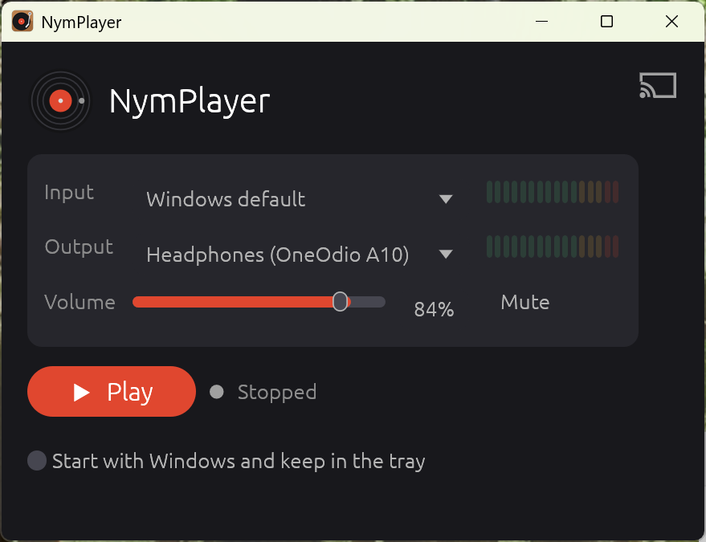

# NymPlayer

[](https://github.com/nymankla/NymPlayer/actions/workflows/ci.yml)
[](https://github.com/nymankla/NymPlayer/releases/latest)
[](LICENSE)

A small Windows app that plays live audio from an input device, such as a USB audio interface or line-in, through any output device, such as speakers or Bluetooth headphones.

**[⬇ Download the latest version](https://github.com/nymankla/NymPlayer/releases/latest)**: a single `.exe`, no installer.



## Install

NymPlayer is a single program file. There's no installer and no extra software to install.

1. Open the [latest release](https://github.com/nymankla/NymPlayer/releases/latest) and download `NymPlayer-vX.Y.Z-windows-x64.exe` under **Assets**.
2. Make a folder for it, for example `%LOCALAPPDATA%\Programs\NymPlayer` (paste that into the File Explorer address bar), and move the file there. Keeping it out of Downloads matters if you use **Start with Windows**, because Windows starts the app from wherever the file is.
3. Optionally rename it to `NymPlayer.exe`, then right-click it and choose **Show more options → Send to → Desktop (create shortcut)** or **Pin to Start**.
4. Double-click to run. The first time, Windows SmartScreen may say *"Windows protected your PC"*, because the app isn't code-signed. Click **More info → Run anyway**. Windows remembers this, so it only asks once.

Requires 64-bit Windows 11. Windows 10 should also work but hasn't been tested.

### First use

1. Plug in your USB audio interface (or other input) and turn on your headphones or speakers.
2. Choose the **Input** and **Output** devices, or leave either on **Windows default**.
3. Press **Play**. The level meters show audio coming in and going out.
4. Optional: tick **Start with Windows and keep in the tray** to have NymPlayer start hidden in the system tray when you sign in.

### Update

Quit NymPlayer (right-click the tray icon → **Quit**, or close the window), then replace the `.exe` with the new version. Your settings are kept.

### Uninstall

1. If **Start with Windows** is ticked, untick it first. This removes the autostart entry.
2. Quit NymPlayer and delete the `.exe`.
3. To also remove your settings, delete the folder `%APPDATA%\NymPlayer`.

## Features

- **Pick input and output** from the Windows device lists, or choose "Windows default" to follow the system default device.
- **Play / Stop** to start or stop the audio passthrough.
- **Level meters** for input and output.
- **Volume and mute.**
- **Start with Windows and keep in the tray** (optional). With this on, the app starts hidden in the tray and minimizing hides it there. Click the tray icon to show the window, or right-click for Play/Stop and Quit. Turning it off removes the tray icon and the autostart entry, and the app minimizes normally.
- **Remembers your settings.** Devices, volume and mute are saved. If the app was playing when you closed it, it starts playing again on the next launch.
- **One copy at a time.** Starting NymPlayer again brings the running copy to the front.
- **Automatic device switching**, also while minimized. If the chosen device is unplugged, playback moves to the Windows default and switches back when the device returns. "Windows default" follows changes to the system default.
- **High-quality sample-rate conversion.** Input and output can run at different sample rates. The conversion also continuously adjusts for the small speed difference between the two devices' clocks, so audio doesn't click or drift over long sessions.
- **Mono and integer input.** Mono input is played on both channels, and 16- or 32-bit integer input is accepted as well as float.

## macOS and Linux

NymPlayer is prepared for macOS and Linux: the code builds and its tests pass on both in CI, and all Windows-specific code is isolated in `src/system/`. It hasn't been run with real audio hardware there, though, because I don't have a Mac or a Linux machine to test on. On those systems there's currently no single-instance check, no autostart and no tray icon.

**Help is very welcome!** If you have a Mac or a Linux machine with an audio interface, please try it, report what works and what doesn't, or implement the missing parts in `src/system/other.rs`. See [CONTRIBUTING.md](CONTRIBUTING.md).

## Build from source

Requires the [Rust toolchain](https://rustup.rs) (on Windows, the MSVC toolchain). On Linux, install the ALSA and GTK development packages first, e.g. on Debian/Ubuntu: `sudo apt install libasound2-dev libgtk-3-dev libxdo-dev libayatana-appindicator3-dev libxkbcommon-dev`.

```sh
cargo build --release
target/release/nymplayer.exe
```

Run the tests with `cargo test`.

## Notes

- Settings are stored in `%APPDATA%\NymPlayer\settings.txt`.
- Latency through the app is about 40–50 ms. Bluetooth headphones add their own delay, typically 150–250 ms.
- Devices are remembered by their Windows device ID, so identical devices are told apart; the dropdown numbers them, e.g. "USB Codec (2)". If you plug a USB device into a different port, Windows may give it a new ID, and you'll need to select it again.
- The icon is generated by `assets/make_icon.py` (Python standard library only).

Built with [cpal](https://github.com/RustAudio/cpal) for audio, [egui/eframe](https://github.com/emilk/egui) for the GUI, [rubato](https://github.com/HEnquist/rubato) for resampling, and [ringbuf](https://github.com/agerasev/ringbuf).

## License

[MIT](LICENSE). Contributions are welcome; see [CONTRIBUTING.md](CONTRIBUTING.md) and the [Code of Conduct](CODE_OF_CONDUCT.md).
